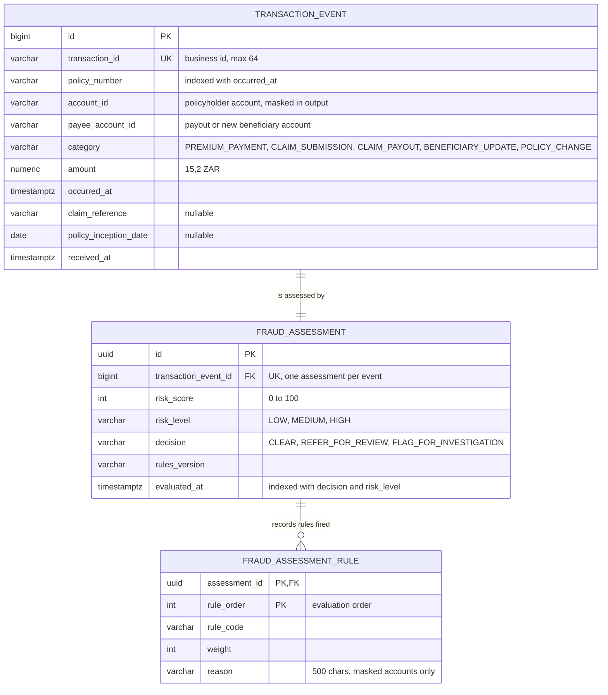

# Entity Relationship Diagram: Fraud Rule Engine

Derived from `src/main/resources/db/migration/V1__create_fraud_schema.sql`.

## Relationships

- **TRANSACTION_EVENT to FRAUD_ASSESSMENT (one to one).** Each event is assessed exactly once. The event and its assessment are written in the same database transaction, so every stored event has an assessment. The unique constraint on `transaction_event_id` enforces the one-to-one rule.
- **FRAUD_ASSESSMENT to FRAUD_ASSESSMENT_RULE (one to many).** An assessment records zero or more fired rules. `rule_order` keeps evaluation order and forms part of the composite primary key.

## Notes

- `policy_number` is not a foreign key. The service has no policy table. Policy history is read by querying `transaction_event` by policy number and a 90-day window.
- `transaction_id` is the business key used by the API. `transaction_event.id` is the internal surrogate key.
- `FRAUD_ASSESSMENT_RULE` is an element collection owned by `FRAUD_ASSESSMENT`, so rule rows are deleted or created only through their parent.
